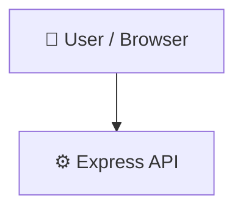

# Ray-Visualization

> Real-time 2D raycasting simulating pseudo-3D environments with HTML5 Canvas.

## 📑 Table of Contents

- [Description](#description)
- [Key Features](#key-features)
- [Use Cases](#use-cases)
- [Tech Stack](#tech-stack)
- [Architecture](#architecture)
- [Quick Start](#quick-start)
- [Key Dependencies](#key-dependencies)
- [Available Scripts](#available-scripts)
- [API Endpoints](#api-endpoints)
- [Project Structure](#project-structure)
- [Development Setup](#development-setup)
- [Contributors](#contributors)
- [Contributing](#contributing)
- [License](#license)

## 📝 Description

Ray-Visualization is a browser-based rendering project that implements real-time 2D raycasting to simulate a pseudo-3D perspective. By projecting rays across a two-dimensional grid and rendering their wall intersections, it recreates the foundational graphics techniques historically used in early 3D video game engines.

The project is constructed around a JavaScript entry point running on an Express.js backend that serves the application's HTML5 Canvas interface and CSS styling. Ray-casting calculations and visual projection are handled directly in client-side JavaScript, updating the canvas dynamically to reflect spatial changes in real time.

This application is designed for developers and students exploring computer graphics fundamentals, computational geometry, and lightweight canvas rendering without the overhead of external 3D frameworks.

## ✨ Key Features

- **📐 Real-Time Raycasting Projection** — Calculates ray intersections across a 2D plane to project a simulated 3D perspective onto the screen.
- **🎨 HTML5 Canvas Rendering** — Draws pseudo-3D frames natively in the browser using the HTML5 Canvas API and vanilla JavaScript.
- **⚡ Express.js Static Server** — Serves the front-end canvas application, layout files, and CSS assets through an Express.js application.
- **🛠️ Configured NPM Scripts** — Includes standard npm script definitions for launching development and testing workflows.

## 🎯 Use Cases

- Learning the mathematical mechanics behind raycasting and early pseudo-3D rendering engines.
- Prototyping canvas-based spatial simulations without complex WebGL dependencies.
- Demonstrating real-time 2D collision and ray intersection algorithms in the browser.

## 🛠️ Tech Stack

 

## 🏗️ Architecture

A high-level view of how the main pieces fit together:



## ⚡ Quick Start

```bash

# 1. Clone the repository
git clone https://github.com/shubhamkumarmurmu/Ray-Visualization.git

# 2. Install dependencies
npm install

# 3. Start the dev server
npm run dev
```

## 📦 Key Dependencies

```
express: ^5.3.0
```

## 🚀 Available Scripts

- **dev** — `npm run dev`
- **test** — `npm run test`

## 📁 Project Structure

```
.
├── css
│   └── index.css
├── index.html
├── index.js
└── package.json
```

## 🛠️ Development Setup

### Node.js / JavaScript
1. Install Node.js (v18+ recommended)
2. Install dependencies: `npm install` (or `yarn` / `pnpm install` / `bun install`)
3. Start the dev server: see the **Quick Start** above

## 👥 Contributing

Contributions are welcome! Here's the standard flow:

1. **Fork** the repository
2. **Clone** your fork: `git clone https://github.com/shubhamkumarmurmu/Ray-Visualization.git`
3. **Branch**: `git checkout -b feature/your-feature`
4. **Commit**: `git commit -m 'feat: add some feature'`
5. **Push**: `git push origin feature/your-feature`
6. **Open** a pull request

Please follow the existing code style and include tests for new behavior where applicable.
